# Отчет по лабораторной работе №4 «Методы и средства оркестрации в многоконтейнерных системах»

**Выполнил(а):** Чжао Аофэй, группа 13
**Дисциплина:** Непрерывная интеграция и сборка программного обеспечения
**Вариант:** группа 13 — задания 1–2

## 1. Цель работы

Изучение создания кластера и работы с Kubernetes.

Задачи работы:

1. Настроить окружение Kubernetes.
2. Выполнить задания.

Согласно критериям оценивания методических указаний: «для групп 10–12 выполнить все 3 задания, для группы 13 — задания 1–2». Таким образом, в работе выполняются **задание 1** (подготовка окружения для локального кластера) и **задание 2** (знакомство с ресурсами Kubernetes); задание 3 (развёртывание приложения) для группы 13 не требуется.

## 2. Задание 1. Подготовка окружения для локального кластера

### 2.1. Используемые утилиты

| Утилита | Версия | Назначение |
|---|---|---|
| Docker Desktop | 29.8.0 | среда выполнения контейнеров (требуется для kind) |
| kubectl | v1.36.1 | клиент командной строки для работы с API Kubernetes |
| kind (Kubernetes IN Docker) | v0.33.0 | создание локального кластера в контейнерах Docker |

Установка kind в Windows:

```powershell
winget install --id Kubernetes.kind -e --accept-source-agreements --accept-package-agreements
```

kubectl уже присутствовал в системе; при необходимости он устанавливается аналогично:

```powershell
winget install --id Kubernetes.kubectl -e
```

### 2.2. Конфигурация кластера

Кластер создаётся из файла `task1/kind-config.yaml`. Выбрана многоузловая конфигурация (1 управляющий + 2 рабочих узла), чтобы продемонстрировать распределение подов по узлам:

```yaml
kind: Cluster
apiVersion: kind.x-k8s.io/v1alpha4
name: lab4
nodes:
  - role: control-plane
  - role: worker
  - role: worker
```

### 2.3. Создание и проверка кластера

```bash
kind create cluster --config kind-config.yaml
```

Результат создания:

```text
Creating cluster "lab4" ...
 ✓ Ensuring node image (kindest/node:v1.37.0) 🖼️
 ✓ Preparing nodes 📦 📦 📦
 ✓ Writing configuration 📜
 ✓ Starting control-plane 🕹️
 ✓ Installing CNI 🔌
 ✓ Installing StorageClass 💾
 ✓ Joining worker nodes 🚜
Set kubectl context to "kind-lab4"
```

Проверка работоспособности:

```text
$ kubectl cluster-info
Kubernetes control plane is running at https://127.0.0.1:50994
CoreDNS is running at https://127.0.0.1:50994/api/v1/namespaces/kube-system/services/kube-dns:dns/proxy

$ kubectl get nodes -o wide
NAME                 STATUS   ROLES           AGE   VERSION   INTERNAL-IP   CONTAINER-RUNTIME
lab4-control-plane   Ready    control-plane   32s   v1.37.0   172.19.0.4    containerd://2.3.4
lab4-worker          Ready    <none>          19s   v1.37.0   172.19.0.2    containerd://2.3.4
lab4-worker2         Ready    <none>          19s   v1.37.0   172.19.0.3    containerd://2.3.4
```

Все три узла находятся в состоянии `Ready` — кластер работает.

## 3. Задание 2. Знакомство с ресурсами Kubernetes

### 3.1. Ресурсы и пространства имён

Все объекты Kubernetes — ресурсы. Список доступных ресурсов с псевдонимами выводит `kubectl api-resources` (в кластере доступен 71 тип ресурсов), список пространств имён — `kubectl get ns`:

```text
$ kubectl get ns
NAME                 STATUS   AGE
default              Active   5m4s
kube-node-lease      Active   5m4s
kube-public          Active   5m4s
kube-system          Active   5m4s
local-path-storage   Active   4m58s
```

### 3.2. Поды кластера и их назначение

Список системных подов (`kubectl get pods -n kube-system`):

```text
NAME                                         READY   STATUS    NODE
coredns-559f6c778d-75bsd                     1/1     Running   lab4-control-plane
coredns-559f6c778d-tl94t                     1/1     Running   lab4-control-plane
etcd-lab4-control-plane                      1/1     Running   lab4-control-plane
kindnet-j6v8s                                1/1     Running   lab4-control-plane
kindnet-ml6q7                                1/1     Running   lab4-worker
kindnet-sx49d                                1/1     Running   lab4-worker2
kube-apiserver-lab4-control-plane            1/1     Running   lab4-control-plane
kube-controller-manager-lab4-control-plane   1/1     Running   lab4-control-plane
kube-proxy-7hg9t                             1/1     Running   lab4-control-plane
kube-proxy-clrf9                             1/1     Running   lab4-worker
kube-proxy-vrxfz                             1/1     Running   lab4-worker2
kube-scheduler-lab4-control-plane            1/1     Running   lab4-control-plane
```

Назначение компонентов:

| Компонент | Назначение |
|---|---|
| `kube-apiserver` | единая точка входа в API кластера: аутентификация, авторизация, валидация объектов; с ним взаимодействуют kubectl и все контроллеры |
| `etcd` | распределённое key-value хранилище — единственный источник истины о состоянии кластера |
| `kube-scheduler` | выбирает узел для каждого нового пода с учётом ресурсов, меток, taints/tolerations, affinity |
| `kube-controller-manager` | набор контроллеров (Node, ReplicaSet, Deployment, Job и др.), приводящих фактическое состояние к желаемому |
| `kube-proxy` | реализует правила маршрутизации Service (iptables/IPVS) на каждом узле |
| `coredns` | DNS-сервер кластера: имена вида `service.namespace.svc.cluster.local` |
| `kindnet` (CNI) | плагин сети: выделяет подам IP, обеспечивает связность между узлами |
| `local-path-provisioner` | динамическое создание PersistentVolume на локальном диске узла (StorageClass `standard`) |

Pod — минимальная единица работы: один или несколько контейнеров, которые гарантированно запускаются вместе на одной ноде. Под создаётся, планируется на подходящий узел, работает и завершается; при падении контейнера kubelet перезапускает его согласно политике `restartPolicy`.

### 3.3. Создание пода

Манифест `task2/pod.yaml`:

```yaml
apiVersion: v1
kind: Pod
metadata:
  name: lab4-web
  labels:
    app: lab4-web
spec:
  containers:
    - name: web
      image: nginx:1.27-alpine
      ports:
        - containerPort: 80
```

```text
$ kubectl apply -f pod.yaml
pod/lab4-web created

$ kubectl get pods -o wide
NAME               READY   STATUS    RESTARTS   AGE   IP           NODE
lab4-web           1/1     Running   0          20s   10.244.2.2   lab4-worker
```

### 3.4. Том и его монтирование в под

Создан PersistentVolumeClaim `task2/pvc.yaml` (1 Gi, режим `ReadWriteOnce`, StorageClass `standard`). Драйвер `rancher.io/local-path` использует стратегию `WaitForFirstConsumer`, поэтому PV создаётся в момент запуска пода, который использует PVC:

```text
$ kubectl get pvc
NAME       STATUS   VOLUME                                     CAPACITY   ACCESS MODES   STORAGECLASS
lab4-pvc   Bound    pvc-974acc55-b84b-41fc-a9eb-27e54acc5adc   1Gi        RWO            standard

$ kubectl get pv
NAME                                       CAPACITY   ACCESS MODES   RECLAIM POLICY   STATUS   CLAIM
pvc-974acc55-b84b-41fc-a9eb-27e54acc5adc   1Gi        RWO            Delete           Bound    default/lab4-pvc
```

Под `task2/pod-with-volume.yaml` монтирует два тома:

```yaml
  volumes:
    - name: data
      persistentVolumeClaim:
        claimName: lab4-pvc     # постоянный том
    - name: cache
      emptyDir: {}              # временный том, удаляется вместе с подом
  containers:
    - name: writer
      volumeMounts:
        - name: data
          mountPath: /data
        - name: cache
          mountPath: /cache
```

Демонстрация монтирования:

```text
$ kubectl logs lab4-volume-demo
=== содержимое постоянного тома /data/log.txt ===
[2026-11-01T16:21:26+00:00] pod started
=== проверка временного тома /cache ===
temporary data
=== точка монтирования ===
/dev/sdd on /data type ext4 (rw,relatime)
/dev/sdd on /cache type ext4 (rw,relatime)

$ kubectl exec lab4-volume-demo -- sh -c "df -h /data; ls -la /data; cat /data/log.txt"
Filesystem                Size      Used Available Use% Mounted on
/dev/sdd               1006.9G     10.9G    944.7G   1% /data
-rw-r--r--    1 root     root           40 Nov  1 16:21 log.txt
[2026-11-01T16:21:26+00:00] pod started
```

Проверка сохранности данных: под был удалён и создан заново; файл `log.txt` в PVC сохранился и дополнен новой записью:

```text
$ kubectl delete pod lab4-volume-demo
$ kubectl apply -f pod-with-volume.yaml
$ kubectl exec lab4-volume-demo -- cat /data/log.txt
[2026-11-01T16:21:26+00:00] pod started
[2026-11-01T16:25:04+00:00] pod started
```

Данные в `emptyDir` (`/cache`) при пересоздании пода были бы потеряны — том живёт ровно столько же, сколько под.

### 3.5. ReplicaSet — коллекция подов

Манифест `task2/replicaset.yaml` задаёт 3 реплики:

```yaml
apiVersion: apps/v1
kind: ReplicaSet
metadata:
  name: lab4-rs
spec:
  replicas: 3
  selector:
    matchLabels:
      app: lab4-rs
  template:
    metadata:
      labels:
        app: lab4-rs
    spec:
      containers:
        - name: web
          image: nginx:1.27-alpine
```

```text
$ kubectl apply -f replicaset.yaml
replicaset.apps/lab4-rs created

$ kubectl get rs,pods -l app=lab4-rs -o wide
NAME      DESIRED   CURRENT   READY
lab4-rs   3         3         3

NAME            READY   STATUS    IP           NODE
lab4-rs-hpsxz   1/1     Running   10.244.2.3   lab4-worker
lab4-rs-hxn6n   1/1     Running   10.244.1.2   lab4-worker2
lab4-rs-wzs9s   1/1     Running   10.244.2.4   lab4-worker
```

Поды распределились по двум рабочим узлам. Проверка самовосстановления: после удаления одного пода контроллер ReplicaSet создал новый, и количество подов вернулось к трём:

```text
$ kubectl delete pod lab4-rs-hpsxz
pod "lab4-rs-hpsxz" deleted

$ kubectl get pods -l app=lab4-rs -o wide
NAME            READY   STATUS    AGE     IP           NODE
lab4-rs-9mlqn   1/1     Running   10s     10.244.1.6   lab4-worker2
lab4-rs-hxn6n   1/1     Running   4m12s   10.244.1.2   lab4-worker2
lab4-rs-wzs9s   1/1     Running   4m12s   10.244.2.4   lab4-worker
```

## 4. Скриншоты

- `images/01-structure.png` — структура репозитория;

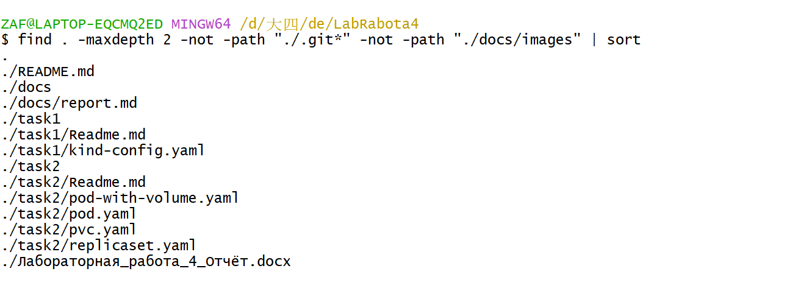
- `images/02-versions.png` — версии `kubectl` и `kind`;

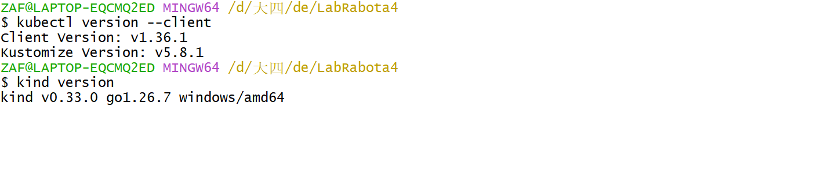
- `images/03-kind-config.png` — `task1/kind-config.yaml`;

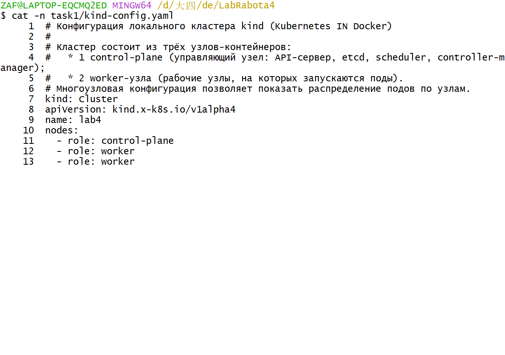
- `images/04-cluster-create.png` — создание кластера (`kind create cluster`);

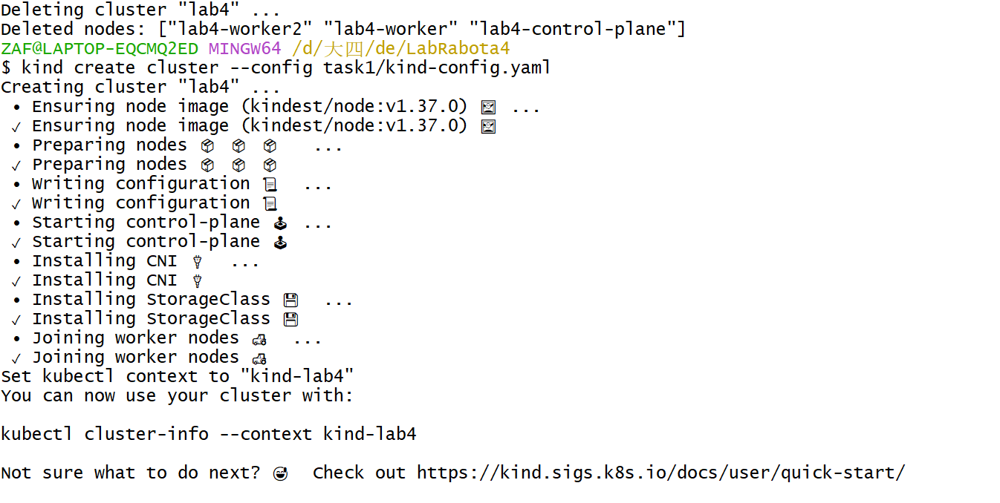
- `images/05-cluster-info.png` — `kubectl cluster-info`;

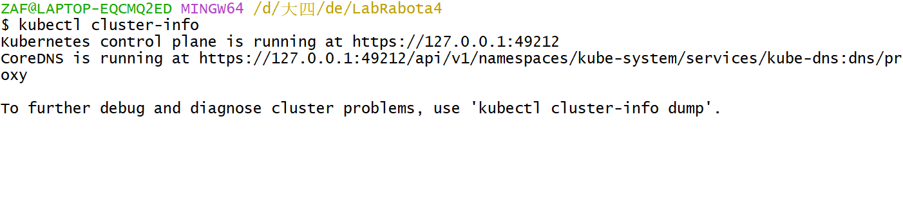
- `images/06-nodes.png` — `kubectl get nodes -o wide` (три узла Ready);

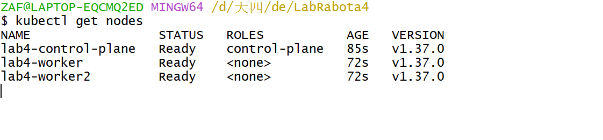
- `images/07-namespaces.png` — `kubectl get ns`;

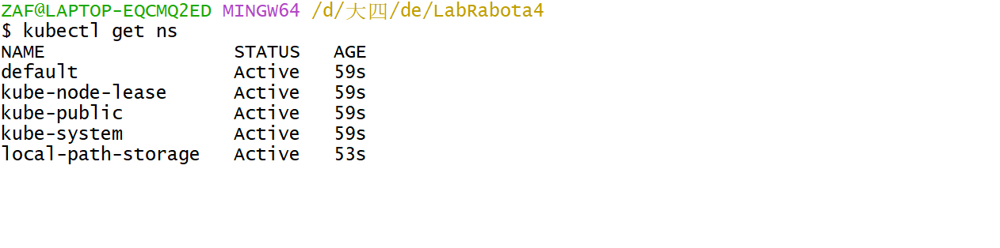
- `images/08-api-resources.png` — `kubectl api-resources`;

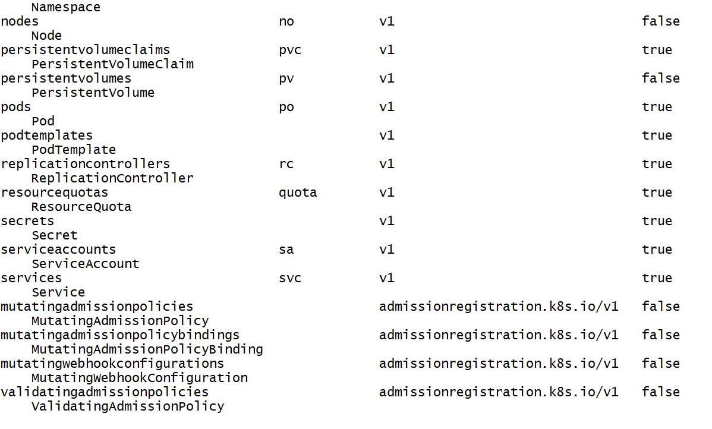
- `images/09-kube-system-pods.png` — `kubectl get pods -n kube-system`;

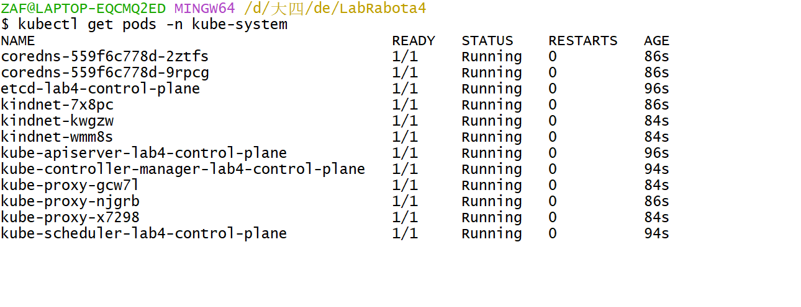
- `images/10-pod-apply.png` — применение `pod.yaml` и `kubectl get pods -o wide`;

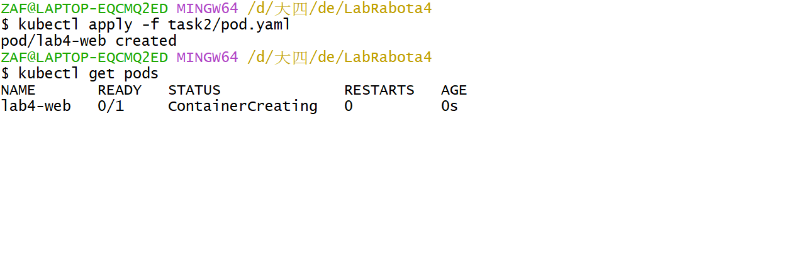
- `images/11-pvc-pv.png` — `kubectl get pvc,pv`;

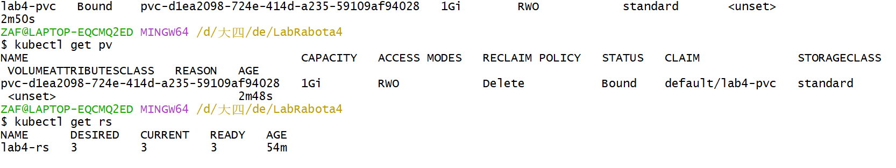
- `images/12-volume-logs.png` — `kubectl logs lab4-volume-demo`;

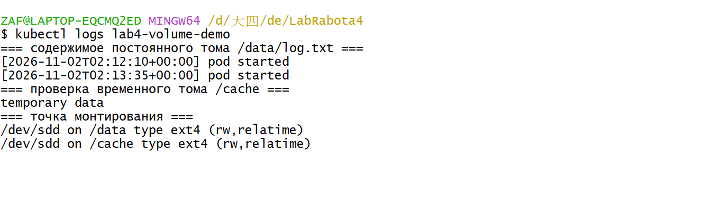
- `images/13-volume-mount.png` — `kubectl exec ... df/ls/cat`;

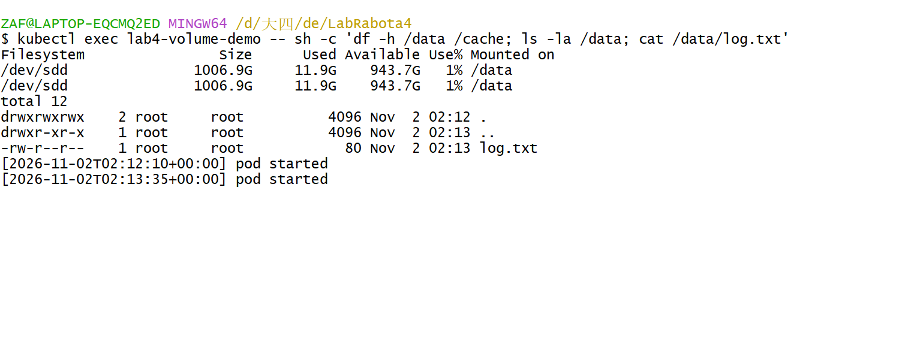
- `images/14-volume-persistence.png` — сохранение данных после пересоздания пода;

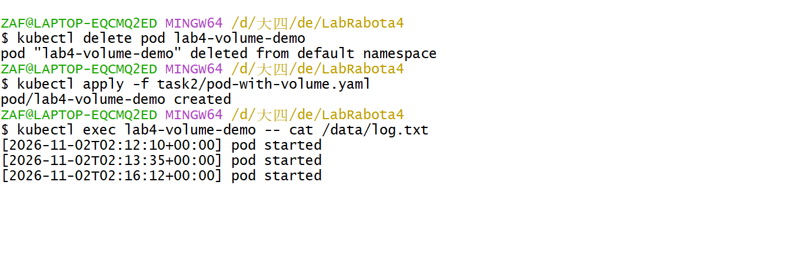
- `images/15-replicaset.png` — `kubectl get rs,pods -l app=lab4-rs -o wide`;

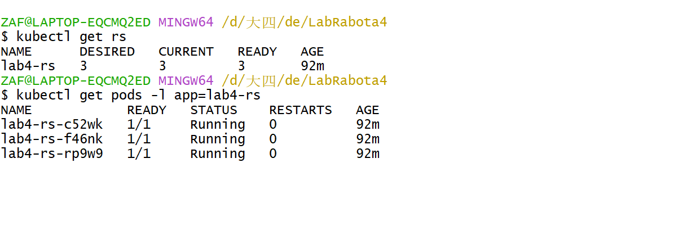
- `images/16-rs-selfheal.png` — удаление пода и появление нового.

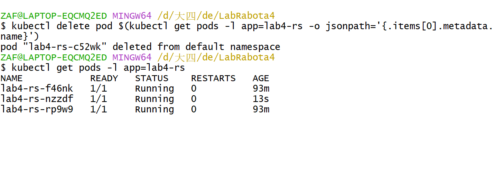

## 5. Ответы на контрольные вопросы

### 1. Что такое Kubernetes и зачем он нужен в работе с контейнерами?

Kubernetes — открытая платформа оркестрации контейнеров (CNCF). Она автоматизирует развёртывание, планирование на узлы, масштабирование, самовосстановление, обновление, балансировку нагрузки, управление конфигурацией и хранилищем для контейнеризованных приложений. Контейнеры сами по себе не решают задачи эксплуатации: кто перезапустит упавший контейнер, на какой сервер его поставить, как найти другие сервисы, как обновить приложение без простоя. Kubernetes описывает желаемое состояние декларативно, а контроллеры постоянно приводят реальное состояние к нему.

### 2. Объясните, в чём отличие «запустить контейнеры вручную через Docker» от «управлять ими в Kubernetes».

| Критерий | Docker вручную / Docker Compose | Kubernetes |
|---|---|---|
| Модель | императивная: `docker run`, `compose up` | декларативная: манифест + контроллеры |
| Масштаб | один хост | кластер из многих узлов |
| Планирование | вручную | планировщик выбирает узел по ресурсам и ограничениям |
| Самовосстановление | только `restart: always` на одном хосте | перезапуск контейнеров, пересоздание подов, перенос с упавшего узла |
| Обнаружение сервисов | имена контейнеров/DNS Compose | Service + CoreDNS, стабильные имена и VIP |
| Обновления | вручную, с простоем | rolling update, откат ревизий |
| Масштабирование | `--scale`, вручную | `replicas`, HPA |
| Конфигурация и секреты | env-файлы | ConfigMap/Secret, RBAC, шифрование |

Compose удобен для локальной разработки, Kubernetes — для эксплуатации в production.

### 3. Приведите 1–2 примера задач, где оркестрация экономит время.

1. **Микросервисное приложение из 15 сервисов, по 3 реплики каждого.** Вручную нужно запустить 45 контейнеров, следить за ними и обновлять по одному. В Kubernetes достаточно манифестов и `kubectl apply`; обновление версии выполняется одной командой с постепенной заменой подов и без простоя.
2. **Отказ узла ночью.** Без оркестрации администратор вручную поднимает контейнеры на другом сервере. Kubernetes через контроллер узла помечает узел `NotReady`, вытесняет поды и планирует их на здоровые узлы автоматически — приложение восстанавливается без участия человека.

### 4. Назовите основные компоненты кластера Kubernetes и опишите, за что каждый отвечает.

**Control plane:**

- `kube-apiserver` — REST-точка входа, аутентификация, авторизация (RBAC), валидация и запись объектов в etcd;
- `etcd` — распределённое хранилище состояния кластера;
- `kube-scheduler` — выбор узла для пода (ресурсы, affinity, taints);
- `kube-controller-manager` — контроллеры, приводящие состояние к желаемому (Node, ReplicaSet, Deployment, Job, Endpoint и др.).

**Рабочий узел:**

- `kubelet` — агент узла: получает PodSpec, запускает и контролирует контейнеры, выполняет пробы;
- `kube-proxy` — правила iptables/IPVS для доступа к Service;
- container runtime (containerd) — непосредственный запуск контейнеров.

**Дополнения:** CoreDNS (DNS), CNI-плагин (сеть), provisioner хранилища, metrics-server.

### 5. Как создать под с помощью YAML-манифеста? Перечислите обязательные поля и объясните, что они задают.

Под создаётся командой `kubectl apply -f pod.yaml` (или `kubectl create -f`). Обязательные поля:

| Поле | Что задаёт |
|---|---|
| `apiVersion` | версия API-группы объекта; для пода — `v1` |
| `kind` | тип ресурса — `Pod` |
| `metadata.name` | имя объекта, уникальное в пределах namespace |
| `spec.containers` | список контейнеров: обязательны `name` и `image` |

Дополнительно: `metadata.labels` (метки для селекторов), `metadata.namespace`, `spec.restartPolicy`, `spec.volumes`, `resources`, `env`.

### 6. Приведите YAML-файл (10–15 строк) для простого пода и прокомментируйте 3–4 ключевых поля. Что произойдёт, если пропустить обязательное поле?

```yaml
apiVersion: v1                  # версия API
kind: Pod                       # тип ресурса
metadata:
  name: demo-pod                # имя пода
  labels:
    app: demo                   # метка для селекторов
spec:
  containers:
    - name: web                 # имя контейнера
      image: nginx:1.27-alpine  # образ
      ports:
        - containerPort: 80     # порт контейнера
```

- `apiVersion: v1` — определяет, какой API-версии соответствует объект; при неверном значении apiserver вернёт ошибку «no matches for kind».
- `metadata.name` — идентификатор пода в namespace; без него объект не будет создан.
- `spec.containers[].image` — образ, который запустит kubelet; при опечатке под перейдёт в `ImagePullBackOff`.
- `spec.containers[].ports.containerPort` — информационное поле (не открывает порт), используется сервисами и документацией.

Если пропустить обязательное поле, apiserver отклонит манифест на этапе валидации: например, без `metadata.name` (и без `generateName`) — `error: name or generateName is required`; без `spec.containers` — `ValidationError(Pod.spec): missing required field "containers"`. Объект в кластер не попадёт. Если же указан несуществующий образ или неверный тег, объект создастся, но под зависнет в состоянии `ErrImagePull`/`ImagePullBackOff`.

### 7. Что такое сервисы в Kubernetes и зачем они нужны? Разница между ClusterIP и Headless-сервисом.

Service — абстракция, дающая стабильную точку доступа к группе подов, выбранных по меткам. Поды эфемерны: их IP меняются при пересоздании, а количество реплик — при масштабировании. Service предоставляет постоянный виртуальный IP и DNS-имя, а kube-proxy распределяет трафик между эндпоинтами.

- **ClusterIP** (по умолчанию) — виртуальный IP, доступный только внутри кластера; трафик балансируется между подами. Пример: `api-svc` с ClusterIP, к которому обращается фронтенд по имени `api-svc`.
- **Headless** (`clusterIP: None`) — виртуального IP нет; DNS возвращает A-записи с IP всех подов, балансировка не выполняется. Нужен, когда клиент должен сам выбрать под или обратиться к конкретному экземпляру: StatefulSet с базой данных (`postgres-0.postgres.default.svc.cluster.local`), gRPC-клиенты с собственным балансировщиком, кластеры Kafka/Elasticsearch.

### 8. Чем отличаются сервисы NodePort и LoadBalancer? Пошагово, как внешний пользователь попадает в под.

**NodePort.** Kubernetes открывает один и тот же порт (30000–32767) на **каждом** узле и перенаправляет его на сервис:

1. пользователь обращается на `http://<IP-узла>:30080`;
2. пакет приходит на узел, где kube-proxy настроил правило DNAT для этого порта;
3. трафик направляется на ClusterIP сервиса, затем на один из подов-эндпоинтов;
4. ответ возвращается через тот же узел.

**LoadBalancer.** Дополнительно к NodePort создаётся внешний балансировщик облачного провайдера:

1. провайдер выделяет публичный IP и создаёт балансировщик;
2. балансировщик проверяет здоровье узлов и распределяет трафик на NodePort всех узлов;
3. kube-proxy на узле перенаправляет запрос на под;
4. пользователь работает с внешним IP, не зная об узлах.

Отличия: NodePort требует знать IP узла и не балансирует между узлами; LoadBalancer даёт стабильный внешний IP, L4-балансировку и health checks, но зависит от облачного провайдера (в kind/Minikube без MetalLB адрес остаётся `<pending>`).

### 9. Какие порты задействованы и какие ограничения есть у NodePort?

Задействованы три порта:

- `port` — порт самого Service (внутри кластера);
- `targetPort` — порт контейнера в поде;
- `nodePort` — порт на каждом узле, по умолчанию из диапазона **30000–32767** (настраивается параметром apiserver `--service-node-port-range`).

Ограничения:

- фиксированный диапазон и требование уникальности nodePort в кластере;
- порт открывается на всех узлах, что расширяет поверхность атаки;
- нет маршрутизации по HTTP (L7): нельзя разделить трафик по хостам и путям, нет TLS-терминации;
- нет настоящей балансировки и health checks (только правила DNAT);
- клиенту нужно знать IP узла, который может измениться;
- при облачной инфраструктуре требует настройки firewall/security groups;
- не подходит как единая точка входа для десятков сервисов — для этого используется Ingress.

### 10. Пример, когда NodePort достаточно, а когда нужен LoadBalancer.

**NodePort достаточно:** учебный или тестовый кластер в локальной сети (kind, Minikube, on-prem без облачного провайдера), где нужно быстро открыть одно приложение наружу, например `http://192.168.1.50:30080` для проверки работы сервиса коллегами. Также подходит для внутренних утилит и временных демонстраций.

**Нужен LoadBalancer:** production-приложение в облаке с публичным доменом, где требуется стабильный внешний IP, автоматическая балансировка между узлами, health checks, TLS и масштабирование без изменения адреса; либо несколько сервисов, каждый из которых должен быть доступен по своему адресу.

### 11. Что такое Ingress и какую проблему он решает? Пример манифеста с одним правилом.

Ingress — объект, описывающий правила HTTP/HTTPS-маршрутизации с внешнего мира к сервисам кластера. Решает проблему «по одному NodePort/LoadBalancer на каждый сервис»: вместо множества внешних портов появляется единая точка входа, маршрутизация по хосту и пути, TLS-терминация и централизованные правила. Требует установленного ingress-контроллера (например, ingress-nginx), который читает объекты Ingress и настраивает прокси.

```yaml
apiVersion: networking.k8s.io/v1
kind: Ingress
metadata:
  name: shop-ingress
spec:
  rules:
    - host: shop.example.com
      http:
        paths:
          - path: /api
            pathType: Prefix
            backend:
              service:
                name: api-svc
                port:
                  number: 80
```

Как направляется трафик: клиент запрашивает `http://shop.example.com/api/orders` → DNS указывает на IP ingress-контроллера → контроллер выбирает правило по хосту `shop.example.com` и пути `/api` → проксирует запрос в Service `api-svc:80` → kube-proxy направляет его на один из подов приложения.

### 12. Сравнение Deployment, StatefulSet и DaemonSet.

| Критерий | Deployment | StatefulSet | DaemonSet |
|---|---|---|---|
| Цель | stateless-приложения (веб, API) | stateful-приложения (БД, Kafka, Zookeeper) | по одному поду на каждом узле (агенты) |
| Создание подов | параллельно, поды взаимозаменяемы | упорядоченно: `-0`, `-1`, `-2`, каждый со своим PVC и стабильным DNS-именем | по одному на каждый узел, включая новые |
| Привязка | не привязаны к узлам | не привязаны к узлам, но привязаны к своим томам | привязаны к узлам |
| Пример | фронтенд интернет-магазина | PostgreSQL/кластер Kafka | агент сбора логов (Fluent Bit), node-exporter |
| При масштабировании до 3 реплик | создаются 3 одинаковых пода, распределяются по узлам, доступны через один Service | последовательно создаются `db-0`, `db-1`, `db-2`, у каждого свой том и имя | «реплик» нет: под запускается на каждом из 3 узлов — 3 пода |

### 13. В чём разница между Job и CronJob? Примеры. Как проверить выполнение?

**Job** — одноразовая задача, которая выполняется до успешного завершения заданного числа раз (`completions`, `parallelism`). Пример: миграция схемы БД, пакетная обработка файлов, однократный расчёт.

**CronJob** — задача по расписанию в cron-формате; создаёт Job по расписанию. Пример: ночной бэкап БД, ежечасная выгрузка отчёта, очистка временных файлов.

Проверка:

```bash
kubectl get jobs                 # COMPLETIONS 1/1, STATUS Complete
kubectl describe job <name>      # события, условия
kubectl logs job/<name>          # вывод задачи
kubectl get pods                 # поды job завершаются со статусом Completed
kubectl get cronjob              # LAST SCHEDULE, SUSPEND, ACTIVE
kubectl get jobs --watch         # появление новых Job по расписанию
```

### 14. Для чего нужны ConfigMap и Secret? Два способа передать данные в под.

ConfigMap хранит несекретную конфигурацию (параметры приложения, файлы конфигурации), Secret — конфиденциальные данные (пароли, токены, TLS-сертификаты, ключи). Оба позволяют отделить конфигурацию от образа: один и тот же образ используется в dev/stage/prod с разными настройками.

Способы передачи:

1. **Переменные окружения** — `env.valueFrom.configMapKeyRef` / `secretKeyRef` или `envFrom`. Удобно для небольших параметров; изменения требуют пересоздания подов.
2. **Монтирование томом** — `volumes[].configMap` / `volumes[].secret` и `volumeMounts`. Удобно для конфигурационных файлов и сертификатов; обновления ConfigMap/Secret подхватываются в смонтированных файлах автоматически (с задержкой), Secret монтируется в tmpfs.

### 15. YAML для ConfigMap и Secret. Почему пароли нельзя хранить в ConfigMap?

```yaml
apiVersion: v1
kind: ConfigMap
metadata:
  name: app-config
data:
  APP_MODE: production
  LOG_LEVEL: info
---
apiVersion: v1
kind: Secret
metadata:
  name: app-secret
type: Opaque
data:
  DB_PASSWORD: c3VwZXJzZWNyZXQ=   # base64 от "supersecret"
```

Пароли нельзя хранить в ConfigMap, потому что:

- ConfigMap не предназначен для конфиденциальных данных и хранится в etcd **в открытом виде** (без шифрования at-rest, если оно не включено отдельно);
- любой пользователь или сервисная учётная запись с правом `get configmaps` увидит пароль; в Secret можно ограничить доступ отдельной политикой RBAC;
- значения ConfigMap выводятся в `kubectl describe`, попадают в логи, дампы и системы контроля версий;
- Secret можно шифровать at-rest, монтировать в tmpfs и использовать внешние хранилища (Vault, sealed-secrets).

При этом важно помнить: base64 — это **кодирование, а не шифрование**; Secret защищён организационно (RBAC, шифрование, аудит), а не самим форматом.

### 16. 8–10 основных команд kubectl, сгруппированных по задачам.

| Задача | Команды |
|---|---|
| Посмотреть состояние | `kubectl get pods,svc,deploy -o wide`, `kubectl describe pod <name>`, `kubectl logs <pod> [-f]`, `kubectl get events --sort-by=.lastTimestamp` |
| Создать/обновить | `kubectl apply -f <file>`, `kubectl create ...`, `kubectl edit ...`, `kubectl scale ...`, `kubectl set image ...`, `kubectl rollout status ...` |
| Удалить | `kubectl delete -f <file>`, `kubectl delete pod <name>`, `kubectl drain <node>` |
| Отладить | `kubectl exec -it <pod> -- sh`, `kubectl port-forward <pod> 8080:80`, `kubectl cp`, `kubectl debug` |

Итого десять наиболее употребительных: `get`, `describe`, `logs`, `apply`, `create`, `delete`, `exec`, `port-forward`, `scale`, `rollout status`.

### 17. Что такое пространства имён и зачем они используются? 2–3 примера.

Namespace — логическое разделение ресурсов одного кластера: имена объектов уникальны внутри namespace, а не в кластере. Позволяет применять RBAC, квоты (`ResourceQuota`), лимиты и сетевые политики отдельно для каждой группы.

Примеры:

1. `dev`, `stage`, `prod` — одинаковые имена приложений в разных средах, разные квоты и права;
2. отдельный namespace на команду (`team-a`, `team-b`) — изоляция доступа и ресурсов;
3. `kube-system` — системные компоненты, `monitoring` — Prometheus/Grafana, `ingress-nginx` — контроллер Ingress.

### 18. Как создать новое пространство имён и как выполнять команды только в нём?

```bash
kubectl create namespace lab4
# или манифестом: kubectl apply -f namespace.yaml

# переключить namespace текущего контекста
kubectl config set-context --current --namespace=lab4

# либо указывать явно в каждой команде
kubectl get pods -n lab4
kubectl apply -n lab4 -f pod.yaml
```

Проверить текущий namespace: `kubectl config view --minify -o jsonpath='{..namespace}'`.

### 19. Зачем нужны пробы: livenessProbe, readinessProbe и startupProbe?

- **livenessProbe** — проверяет, жив ли контейнер; при неудаче kubelet перезапускает его (лечит зависания и взаимоблокировки).
- **readinessProbe** — проверяет готовность принимать трафик; при неудаче под исключается из эндпоинтов Service, но не перезапускается (например, приложение ещё прогревает кэш или зависит от БД).
- **startupProbe** — проверяет, что приложение запустилось; пока она не успешна, liveness- и readiness-пробы не выполняются. Нужна для медленно стартующих приложений, чтобы liveness не убила контейнер во время инициализации.

Типы проверок: `httpGet`, `tcpSocket`, `exec`, `grpc`; параметры `initialDelaySeconds`, `periodSeconds`, `timeoutSeconds`, `failureThreshold`, `successThreshold`.

### 20. Что такое PersistentVolume и PersistentVolumeClaim? Как выделяется место?

**PersistentVolume (PV)** — ресурс кластера, представляющий реальное хранилище (локальный диск, NFS, облачный диск EBS). **PersistentVolumeClaim (PVC)** — заявка пользователя на том определённого размера и режима доступа. PVC связывается (bind) с подходящим PV один-к-одному; под ссылается на PVC в `spec.volumes`.

Выделение места:

- **статическое** — администратор заранее создаёт PV, PVC находит подходящий по размеру, классу и режиму доступа;
- **динамическое** — PVC содержит `storageClassName`, provisioner этого класса создаёт PV автоматически (в kind — `rancher.io/local-path`, в облаке — CSI-драйвер).

В работе использован динамический вариант: PVC `lab4-pvc` (1 Gi, `ReadWriteOnce`) → автоматически создан PV `pvc-974acc55-...` ёмкостью 1 Gi, статус `Bound`. Режимы доступа: `ReadWriteOnce`, `ReadOnlyMany`, `ReadWriteMany`, `ReadWriteOncePod`; политика возврата (`reclaimPolicy`) — `Delete` или `Retain`.

### 21. Как Kubernetes реагирует, если под или узел «упали»? 2–3 механизма самовосстановления.

1. **Перезапуск контейнера.** kubelet действует по `restartPolicy` (по умолчанию `Always`): упавший контейнер перезапускается с экспоненциальной задержкой; при повторных падениях — `CrashLoopBackOff`.
2. **Пересоздание пода контроллером.** Если под удалён или узел его потерял, ReplicaSet/Deployment/StatefulSet замечает расхождение фактического числа подов с `replicas` и создаёт новый под. Проверено в работе: после `kubectl delete pod` новый под появился за ~10 секунд.
3. **Реакция на отказ узла.** Контроллер узла помечает узел `NotReady` при отсутствии heartbeat (по умолчанию ~40 с), затем поды вытесняются (toleration ~5 минут) и планировщик размещает их на здоровых узлах. `kube-proxy` перестаёт направлять трафик на недоступные эндпоинты, а пробы исключают неготовые поды из Service.

### 22. Как обновлять приложение без простоя? Rolling update и его параметры.

Rolling update — постепенная замена подов старой версии на новую: создаётся новый ReplicaSet, поды заменяются по одному, трафик получают только готовые поды. Простой отсутствует, если реплик больше одной и настроены readiness-пробы.

Параметры `spec.strategy.rollingUpdate`:

- `maxSurge` — сколько подов сверх `replicas` можно создать одновременно (по умолчанию 25%);
- `maxUnavailable` — сколько подов может быть недоступно в процессе (по умолчанию 25%);
- `minReadySeconds` — сколько под должен быть готов, прежде чем считать его доступным;
- `progressDeadlineSeconds` — время, после которого обновление считается неуспешным;
- `revisionHistoryLimit` — число хранимых ревизий для отката.

Дополнительно: `RollingUpdate` для Deployment, `OnDelete` для ручного управления; для StatefulSet — упорядоченное обновление в обратном порядке.

### 23. Как запустить обновление приложения в кластере и как следить за прогрессом?

```bash
# обновить образ
kubectl set image deployment/lab4-web web=nginx:1.28-alpine
# либо применить изменённый манифест
kubectl apply -f deployment.yaml

# следить за прогрессом
kubectl rollout status deployment/lab4-web
kubectl get pods -w
kubectl describe deployment lab4-web

# история и откат
kubectl rollout history deployment/lab4-web
kubectl rollout undo deployment/lab4-web
kubectl rollout undo deployment/lab4-web --to-revision=1
```

`rollout status` показывает, сколько подов обновлено и осталось; при зависании (`ProgressDeadlineExceeded`) обновление можно прервать и откатить. В данной работе использовался ReplicaSet (без стратегии обновления), поэтому для задания 3 (не требуется группе 13) обновление выполнялось бы через Deployment.

## 6. Вывод

В ходе работы установлены утилиты kubectl и kind, создан локальный трёхузловой кластер Kubernetes (control-plane + 2 worker) на базе kind и Docker, проверена его работоспособность (`kubectl cluster-info`, все узлы в состоянии `Ready`). Изучены ресурсы кластера: пространства имён, системные поды и их назначение, Pod, PersistentVolumeClaim/PersistentVolume и ReplicaSet. Продемонстрировано монтирование постоянного и временного томов в под, сохранение данных после пересоздания пода, работа ReplicaSet с тремя репликами, распределение подов по узлам и автоматическое восстановление после удаления пода. Полученные результаты подтверждают, что локальный кластер Kubernetes настроен корректно и позволяет выполнять базовые операции оркестрации контейнеров.
